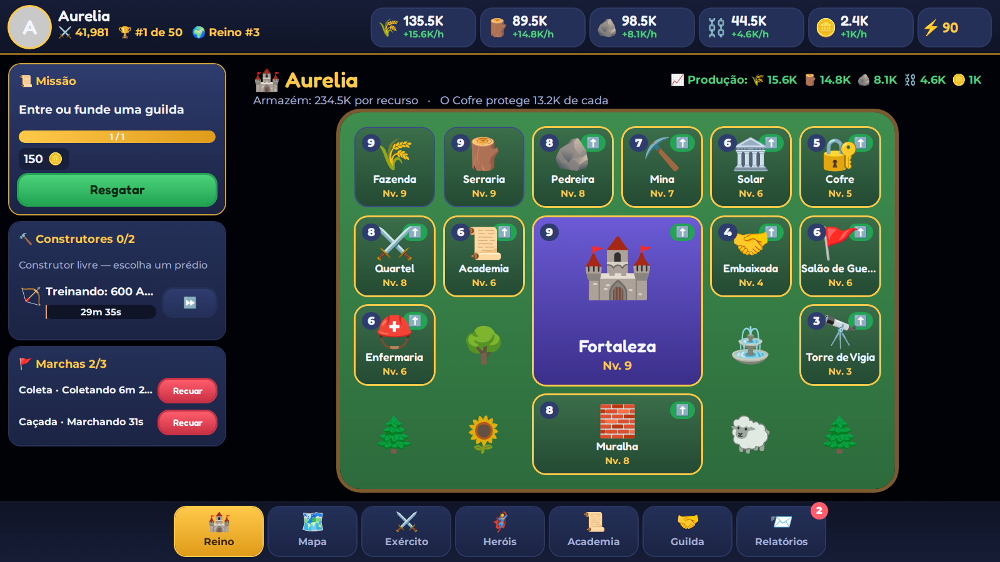
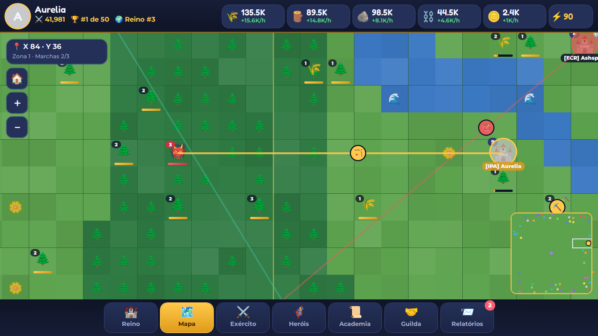
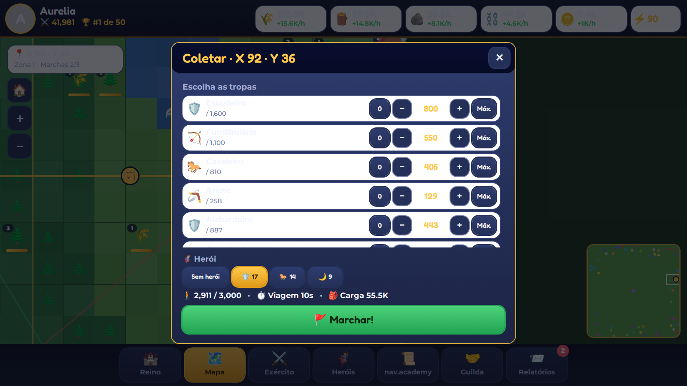
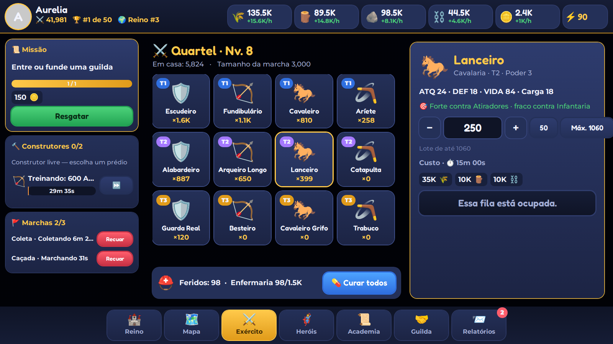
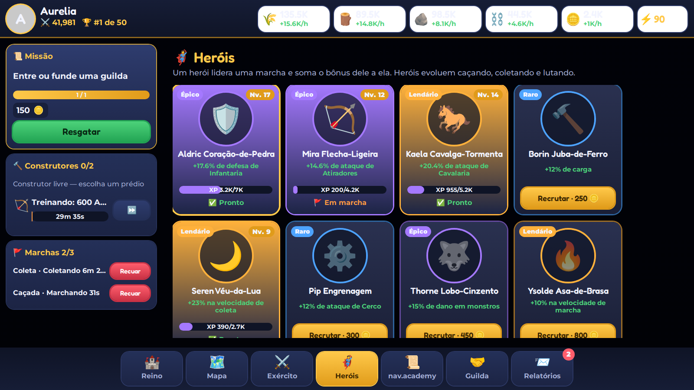
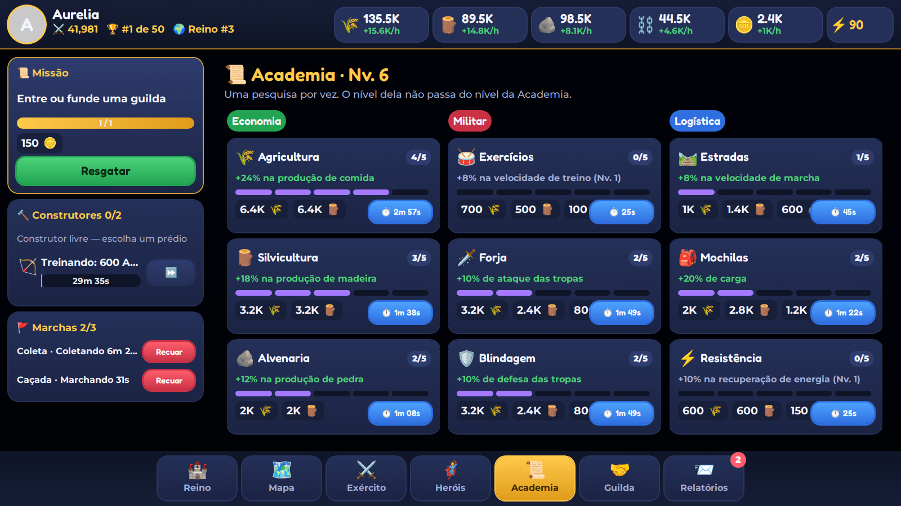
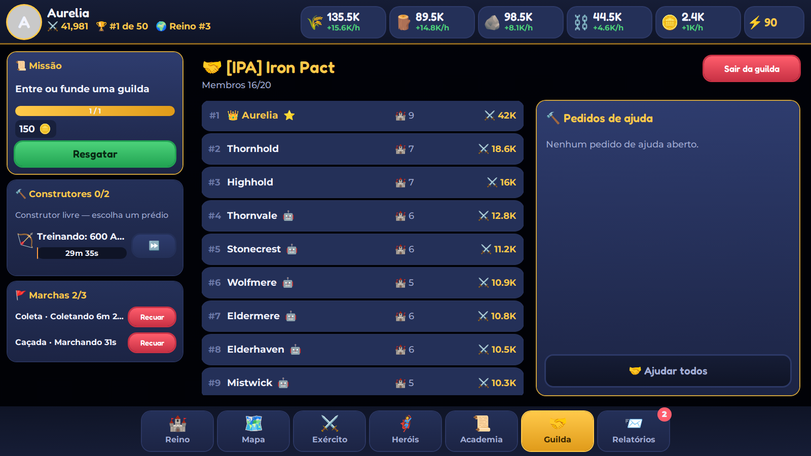
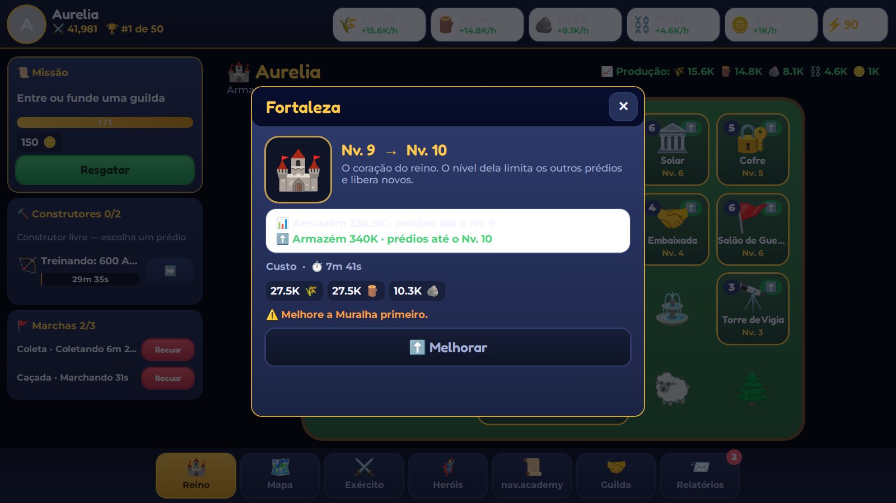
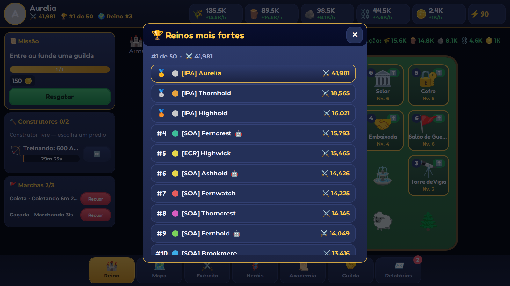

# 🏰 Kingdom of Robloxia

Jogo de **estratégia de reinos** para Roblox, feito **100% em interface 2D de tela cheia** (sem avatar, sem mundo 3D):
você constrói seu castelo, treina exércitos, recruta heróis, pesquisa tecnologias, caça monstros, coleta recursos no
mapa, entra em guildas e ataca outros reinos. O gênero é o dos MMOs de estratégia de reinos para celular; o jogo,
os nomes, os heróis e os números são originais.

- **Até 50 reinos por servidor:** 20 jogadores reais + 30 bots que jogam com as mesmas regras.
- **Mapa médio de 96×96** em 4 zonas concêntricas (as do centro têm campos mais ricos e monstros mais fortes).
- **Servidor autoritativo:** toda regra roda no servidor; o cliente só mostra o estado e envia ordens validadas.
- **Português e inglês** (escolhido pelo idioma da conta Roblox).
- **Nada roda na máquina de ninguém:** formatação, lint, tipos, testes, build, screenshots e deploy rodam no GitHub
  Actions.

## Imagens

As imagens abaixo são geradas pelo GitHub Actions a partir do **código real da interface em Luau**: o Lune executa
`UI/App.luau` com os dados de uma partida simulada (50 reinos, bots jogando 30 minutos) e um renderizador web aplica as
regras de layout do Roblox (UDim2, AnchorPoint, UIListLayout, UIGridLayout, UICorner, UIStroke, UIGradient). As fontes
são equivalentes web das do Roblox (Fredoka ↔ Fredoka One, Montserrat ↔ Gotham), então o resultado é muito próximo, mas
não um print do Roblox Studio.

| | |
|---|---|
|  |  |
| **Reino:** prédios, filas, missão e marchas | **Mapa:** terreno, castelos, campos, monstros e marchas ao vivo |
|  |  |
| **Marcha:** tropas, herói, tempo e carga | **Exército:** 12 tropas em 4 classes e 3 níveis |
|  |  |
| **Heróis:** 8 heróis com bônus próprios | **Academia:** 12 pesquisas em 3 ramos |
|  |  |
| **Guilda:** membros e ajuda mútua | **Relatórios:** batalhas, caçadas, coletas, espionagem |
|  |  |
| **Prédio:** efeito atual e próximo, custo, requisitos | **Ranking:** os reinos mais fortes do servidor |

Celular (layout compacto) e inglês: [`12-phone-kingdom`](docs/screenshots/12-phone-kingdom.png),
[`13-phone-map`](docs/screenshots/13-phone-map.png), [`11-kingdom-en`](docs/screenshots/11-kingdom-en.png).

## Como se joga

| Sistema | Resumo |
|---|---|
| **Reino** | 14 prédios (Fortaleza, Fazenda, Serraria, Pedreira, Mina, Solar, Quartel, Muralha, Enfermaria, Cofre, Academia, Embaixada, Salão de Guerra, Torre de Vigia). Nenhum prédio passa o nível da Fortaleza; a Fortaleza precisa da Muralha. |
| **Recursos** | Comida, madeira, pedra, minério e ouro. Produção por hora com limite de armazém; o Cofre esconde parte dos saqueadores. |
| **Exército** | Infantaria > Cavalaria > Atiradores > Infantaria (+30%/−20%); Cerco derruba a muralha. Batalhas determinísticas em 6 rodadas. Perdas viram feridos enquanto a Enfermaria tiver vaga. |
| **Heróis** | 8 heróis (raros, épicos, lendários). Um herói lidera uma marcha e dá bônus de ataque, defesa, carga, coleta, caça ou velocidade. Sobem de nível em caçadas, coletas e batalhas. |
| **Mapa** | Coletar em campos, caçar monstros (gasta energia, nunca mata tropas), atacar e espionar castelos, mudar o castelo de lugar. |
| **Guildas** | Membros nunca se atacam e ajudam a acelerar obras e pesquisas. Nome escolhido de uma lista de palavras: nenhum texto livre de jogador precisa de moderação. |
| **Proteção** | Escudo de iniciante até a Fortaleza 5 (perde ao atacar) e 10 min de escudo após uma derrota, contra "farm" do mesmo reino. |
| **Missões** | Uma corrente de 12 missões que ensina um sistema por vez. |

Os números estão todos em [`src/shared/Rules/Balance.luau`](src/shared/Rules/Balance.luau).

## Arquitetura

```
src/shared/Rules/   regras puras em Luau (sem API do Roblox): economia, cidade, exército, combate, mapa, mundo, bots
src/shared/Locale   textos em inglês e português
src/server/         Roblox: DataStore com trava de sessão, rate limit, loop do reino e envio só do que mudou
src/client/Kit      mini biblioteca de UI declarativa com diff (só altera o que mudou)
src/client/UI       App, componentes e as telas (Reino, Mapa, Exército, Heróis, Academia, Guilda, Relatórios)
tests/              testes Lune que carregam os módulos reais (incl. simulação de 2 h com 50 reinos)
tools/render.luau   exporta a UI real para JSON (screenshots)
preview/            renderizador web (TypeScript + Vite) e script de screenshots (Playwright)
```

Detalhes em [`docs/ARCHITECTURE.md`](docs/ARCHITECTURE.md) e as recomendações e próximos passos em
[`docs/RECOMMENDATIONS.md`](docs/RECOMMENDATIONS.md).

## Pipeline (GitHub Actions)

| Workflow | Quando | O que faz |
|---|---|---|
| **CI** | push e pull request | StyLua (formato), Selene (lint), luau-lsp (tipos estritos), testes Lune, `rojo build` do `.rbxl`, Prettier + ESLint + TypeScript do preview, screenshots (artefatos `place` e `screenshots`) |
| **Autofix** | push em `claude/**` e `feature/**` | formata Luau e TypeScript, regenera `docs/screenshots/` e faz commit no branch |
| **Deploy** | push na `main` (versão *Saved*) ou manual (*Saved* ou *Published*) | roda os testes, gera o place e publica via Open Cloud; define o tamanho do servidor para 20 |

Ferramentas fixadas em [`rokit.toml`](rokit.toml): Rojo, StyLua, Selene, Lune e luau-lsp.

### Secrets do deploy

| Secret | Conteúdo |
|---|---|
| `ROBLOX_CLOUD_API` | chave da Open Cloud com permissão **universe-places: write** para a experiência |
| `ROBLOX_UNIVERSE_ID` | ID do universo (experiência) |
| `ROBLOX_LOCAL_ID` | ID do place dentro do universo |

Na experiência, ative **"Enable Studio Access to API Services"** e o DataStore funciona; sem ele, o jogo roda em memória
no Studio (sem salvar).

## Licença

Ainda não definida pelo dono do repositório.
